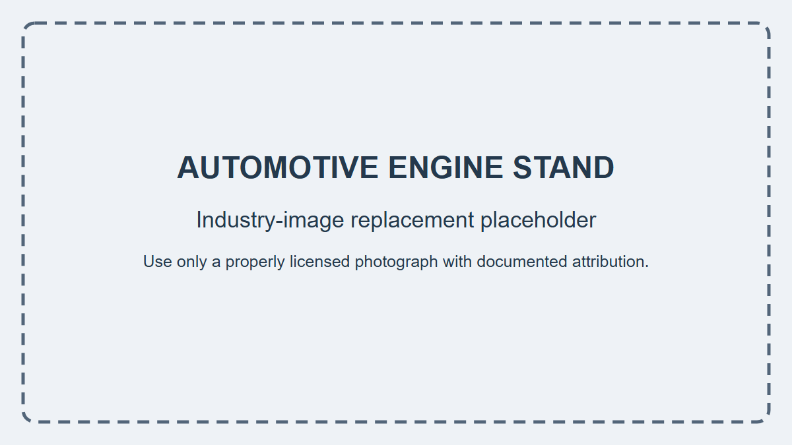

# Engineering Context

{fig-alt="Placeholder for a future properly licensed automotive engine stand photograph." width=72%}

::: {.callout-warning title="Temporary photograph excluded"}
The Amazon product photograph used during faculty development is not included because its redistribution license is unverified. It is application context only; no value in this problem is inferred from it.
:::

An engine stand transfers an engine's weight through adjustable arms and a rotating head into a vertical hollow-steel column, then through the base and casters to the floor. The assigned engine weight acts at a horizontal offset from the column centerline, creating combined axial compression and bending.

Compare two idealized square hollow-steel columns: Candidate A is {{engine_stand_bA_mm}} × {{engine_stand_bA_mm}} × {{engine_stand_tA_mm}} mm and Candidate B is {{engine_stand_bB_mm}} × {{engine_stand_bB_mm}} × {{engine_stand_tB_mm}} mm. Treat all loads, geometry, material properties, and restraint conditions as instructional assumptions—not verified specifications or certification of a photographed product.

# Assigned Data

- engine mass: {{engine_stand_m_kg}} kg; gravity: {{engine_stand_g_m_s2}} m/s²
- load eccentricity: {{engine_stand_e_m}} m; column height: {{engine_stand_H_m}} m
- assigned steel properties: Fy={{engine_stand_Fy_MPa}} MPa, E={{engine_stand_E_GPa}} GPa
- required yield factor of safety: {{engine_stand_n_req}}

The first-order stress calculation uses the eccentricity, not the column height; E is retained as material context but is not needed for this strength-only check.
