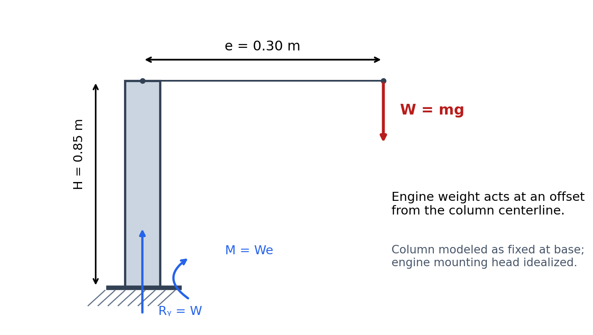

# Purpose

Representative answers support physically defensible reasoning, correct combined-loading mechanics, consistent units, and a scoped recommendation.

::: {.callout-warning title="TODO — IMAGE LICENSE"}
TODO — IMAGE LICENSE: Replace the temporary Amazon product image with a properly licensed photograph or obtain written redistribution permission before public publication. The Amazon image is intentionally excluded. Development reference: <https://www.amazon.com/dp/B0FVXKHCB3>; redistribution license unverified.
:::



## Instructor Reference Idealization

{fig-alt="Instructor schematic showing a fixed vertical column, engine weight W at eccentricity e, height H, and base reactions." width=84%}

## Generated Questions and Solutions

```{=html}
<div id="automotive-engine-stand-combined-loading-instructor-questions"></div>
<script src="../../data/problem-catalog.js"></script><script src="../../scripts/packet-renderer.js"></script>
<script>document.addEventListener("DOMContentLoaded",()=>window.renderProblemPacket({slug:"automotive-engine-stand-combined-loading",targetId:"automotive-engine-stand-combined-loading-instructor-questions",type:"instructor"}));</script>
```

# Model Scope and Value Basis

The model checks gross-section first-order normal stress from axial compression plus uniaxial bending. It excludes welds, bolts, mounting-head details, local or global buckling, tipping, caster and floor reactions, dynamic handling, impact, fatigue, residual stress, and fabrication effects. The 250 MPa yield strength is assigned, not a verified product material specification. Column height and elastic modulus are contextual variables and do not enter this strength-only calculation.
