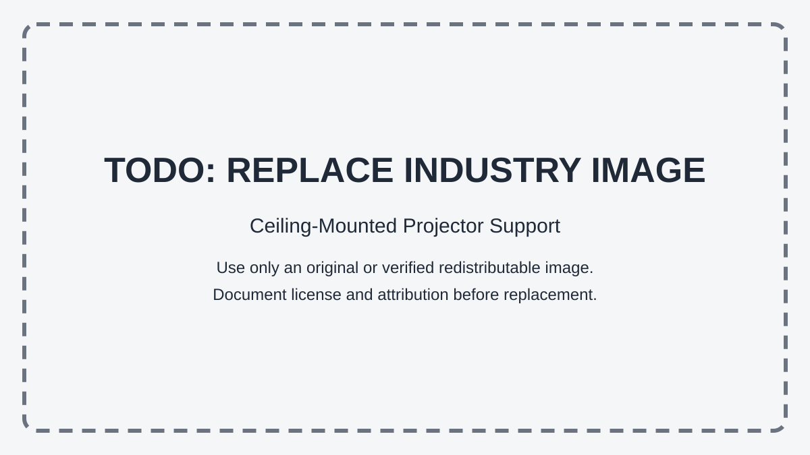

# Context-Rich Solid Mechanics Problem

## Axial Stress and Elongation of a Ceiling-Mounted Projector Support

### Engineering Context

Ceiling-mounted projectors are commonly suspended below a structural ceiling using a vertical support tube and mounting bracket. Under normal service conditions, the projector and mounting hardware act primarily through their weight.

For this problem, the resultant weight is assigned to act through the centroidal axis of the vertical tube. The tube is therefore modeled as a straight, prismatic hollow circular member in axial tension. The analysis evaluates average axial normal stress, axial elongation, and strength-based load capacity.

{fig-alt="Placeholder for a future redistributable photograph of a ceiling-mounted projector and vertical support." width=76%}

::: {.callout-warning title="TODO: REPLACE INDUSTRY IMAGE"}
The original context photograph is restricted and is not included. This placeholder must eventually be replaced by an original or verified redistributable industry image with documented license and attribution.
:::

The 16.3 kg projector mass and extension-column geometry are anchored in published manufacturer documentation. The 1.7 kg accessory allowance, 750 mm suspension length, steel properties, and required factor of safety are instructional assumptions. None of these values is inferred from a photograph, and the context does not identify or certify a specific installed assembly.

### Main Engineering Goal

Determine whether the idealized vertical hollow tube satisfies the assigned axial-yield criterion under normal service loading, quantify its axial elongation, and determine the gross-tube axial capacity associated with the required strength factor of safety. The result is not the allowable capacity of the complete mounting assembly.

### System Components

- ceiling attachment, which transfers support force into the building structure;
- vertical hollow support tube, the member analyzed in axial tension;
- projector mounting bracket, which connects the projector to the tube; and
- projector, which contributes to the suspended service weight.

### Scope of the Model

Use a centered, one-dimensional axial-tension model. Represent the combined projector-and-mount weight as one downward force through the tube centroid. Assume a straight prismatic hollow circular steel tube, a sufficiently rigid ceiling attachment, homogeneous linear-elastic material behavior, and small deformation. Neglect installation eccentricity, lateral loading, bending, compression, vibration, fatigue, impact, and local stresses at threads, bolts, clamps, holes, welds, and bracket interfaces.
