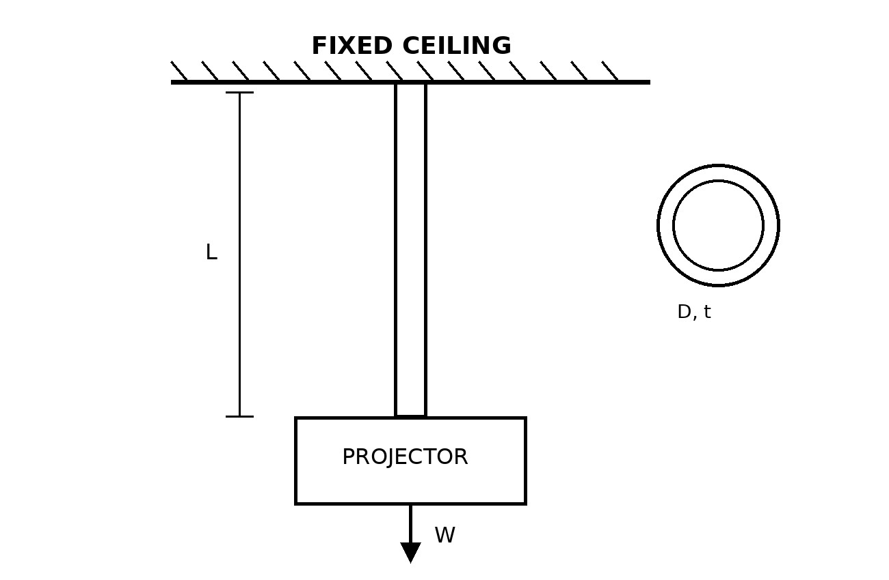

# Purpose

These answers are representative, not the only acceptable responses. Award credit for physically defensible reasoning, a complete idealization, correct mechanics, consistent units, and an engineering conclusion supported by the analysis.

::: {.callout-warning title="TODO: REPLACE INDUSTRY IMAGE"}
The supplied industry photograph is not cleared for public redistribution and is intentionally excluded from this repository. Replace the student placeholder only with an original or verified redistributable image, and record its license and attribution. Keep this reminder and the associated open GitHub issue until replacement is complete.
:::

# Problem Context



# Generated Question Set and Solutions

## Instructor Reference Idealization

{fig-alt="Instructor-only schematic showing a fixed ceiling, vertical hollow circular support tube of length L, outside diameter D, wall thickness t, and downward projector weight W." width=76%}

```{=html}
<div id="ceiling-mounted-projector-support-axial-loading-instructor-questions"></div>
<script src="../../data/problem-catalog.js"></script>
<script src="../../scripts/packet-renderer.js"></script>
<script>
document.addEventListener("DOMContentLoaded", () => {
  window.renderProblemPacket({
    slug: "ceiling-mounted-projector-support-axial-loading",
    targetId: "ceiling-mounted-projector-support-axial-loading-instructor-questions",
    type: "instructor"
  });
});
</script>
```

# Scope of the Base Problem

This problem intentionally models the combined projector-and-mount weight as concentric with the hollow support tube, producing axial tension only. It excludes eccentricity, lateral loading, bending, compression, connection-level stresses, vibration, fatigue, impact, and detailed ceiling-attachment or bracket design. The large calculated strength margin illustrates why gross axial yielding may not govern a real projector mount; local connections, installation eccentricity, vibration, manufacturer ratings, and the ceiling structure may control in practice. The calculated capacity is a gross-tube axial-yield result, not the allowable capacity of the complete projector mounting assembly and not approval of an installation.

# Value Basis and References

- Epson documents a 16.3 kg mass for the EB-PU1007W projector; the additional 1.7 kg mounting-accessory allowance is instructor assigned.
- Chief CMS-series documentation provides the nominal 1-1/2 in Schedule 40 extension-column geometry used here: 48.3 mm outside diameter and 3.91 mm minimum wall thickness. This contextual geometry does not identify the depicted installation as a Chief product or establish compatibility.
- The 750 mm length, steel elastic modulus of 200 GPa, 250 MPa yield-strength idealization, and required factor of safety of 2.0 are instructional design inputs.
- Sources: [Epson EB-PU1007W specifications](https://www.epson.co.uk/en_GB/products/projector/professional/eb-pu1007w-projector/p/32082); [Chief CMS-series column instructions](https://manualzz.com/doc/31921208/cms-series-columns-fixed-and-adjustable-length-columns); [Chief CMS440 installation guidance](https://manuzoid.com/manuals/MNLw8-Chief%20KITPS012018%20Preconfigured%20Projector%20Ceiling%20Mount%20Kit%20Installation%20guide).

# Supplemental Assessment Structure

- context interpretation and load path: 20%;
- student idealization and assumptions: 20%;
- mechanics calculations: 40%;
- engineering interpretation and limitations: 20%.
