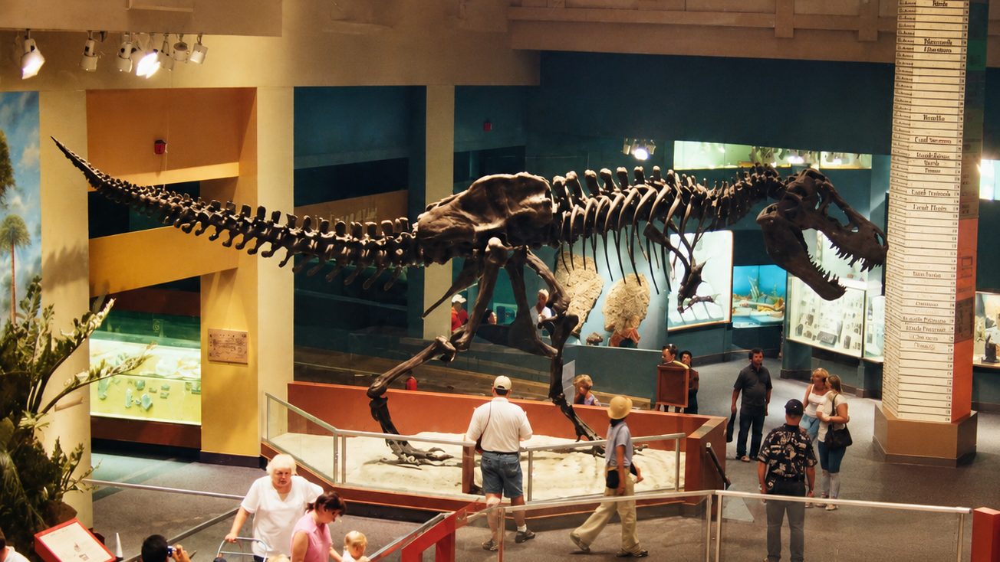

# Context-Rich Solid Mechanics Problem

## Concealed Steel Armature for a Sauropod Dinosaur Tail

### Engineering Context

Museum teams use concealed support systems to present mounted skeletons while preserving the visual impression of a freely extending tail. This problem considers a preliminary teaching model for an equivalent steel armature; it does not analyze the photographed exhibit or claim knowledge of its internal support.

{fig-alt="Museum gallery containing mounted dinosaur skeletons; the elevated tail of the background Diplodocus provides application context." width=82%}

*Application photograph: cropped and resized from [“Diplodocus tail.jpg”](https://commons.wikimedia.org/wiki/File:Diplodocus_tail.jpg) by Lee Ruk (Flickr user gardener41), licensed [CC BY-SA 2.0](https://creativecommons.org/licenses/by-sa/2.0/). The crop changes the framing and file format. The photograph supplies context only; no dimensions, loads, materials, or support details are inferred from it.*

For the assigned mechanics model, a 4.00 m tail-support segment is represented as a straight horizontal steel cantilever rigidly fixed to an equivalent pelvis-region mounting frame. The supported exhibit elements impose a uniform downward load of 150 N/m, excluding the steel armature's self-weight.

Two instructor-assigned rectangular hollow steel sections are compared. Both must fit inside a 150 mm-high by 80 mm-wide concealment envelope, provide a bending-yield factor of safety of at least 2.0, and limit downward tip deflection to 20 mm. The listed sections are teaching geometries, not measurements from the image or verified stocked products.

### Main Engineering Goal

Determine which proposed armature, if either, satisfies bending strength, elastic tip-deflection, and concealment constraints after its own steel self-weight is included. Identify the governing criterion and make a preliminary mechanics-based recommendation.

### System Components

- mounted tail vertebrae and exhibit elements, represented by the assigned exhibit load;
- concealed steel armature, carrying transverse shear and bending while adding self-weight;
- equivalent pelvis-region mounting frame and anchorage, represented as the fixed support;
- primary museum exhibit support and foundation, completing the load path; and
- assigned concealment envelope, limiting the armature's outside dimensions.

### Scope and Provenance

The 4.00 m span, 150 N/m exhibit load, 20 mm deflection limit, 150 × 80 mm envelope, two candidate geometries, and simplified thickness rule are instructor-assigned values. The steel modulus, density, and 345 MPa yield strength are representative teaching values. The model assumes static uniform gravity loading, a straight prismatic beam, an ideal fixed support, strong-axis planar bending, linear elasticity, and small deflection. It excludes detailed bone and cradle loads, connections and welds, local or lateral buckling, torsion, imperfections, visitor impact, vibration, fatigue, installation loads, fabrication tolerances, and certification requirements.
