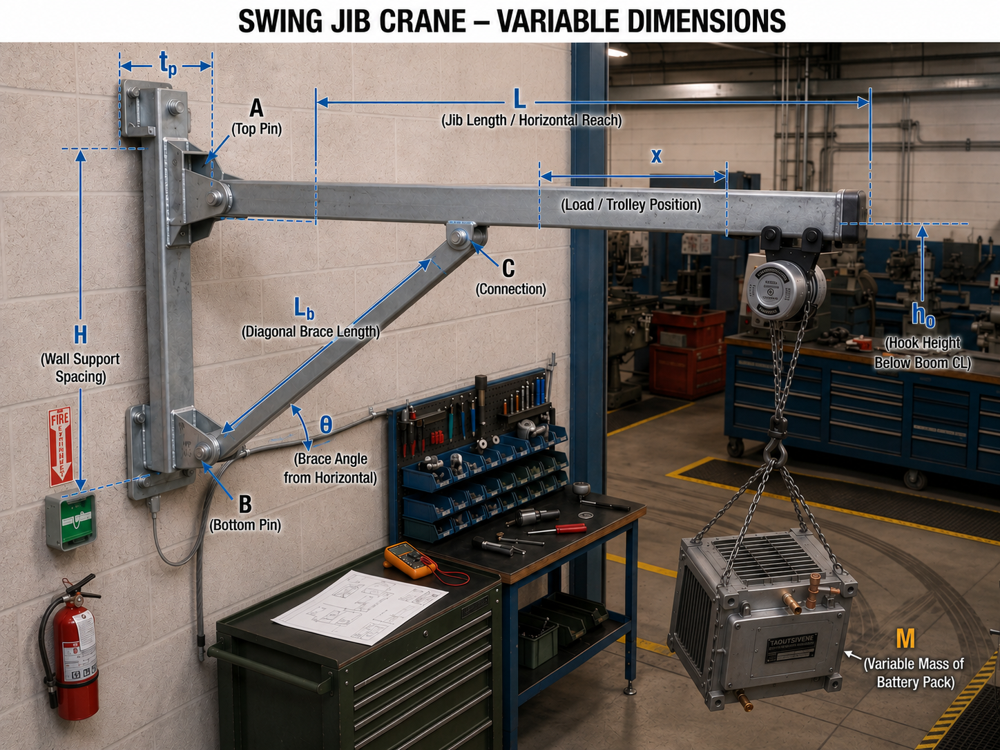

## Physical context

You are studying a wall-mounted swing-jib crane concept for repeated battery-pack handling at an automotive workstation. The concept illustration shows a boom, a lower diagonal brace, a trolley/hoist and a suspended load. Use it to discuss function, material choices, load paths and missing design evidence. It is a context illustration, not a measured installation or a definition of the numerical model.

First develop your own structural idealization and free-body diagrams in task I1. State the restraints, load transfer and omitted effects you assume. Different defensible idealizations may be proposed at this stage.

**Context illustration only.** Context illustration only. Historical diagonal L_b, wall-spacing H, hook-height h_0 and inboard trolley labels do not define the numerical variables or load position. The numerical model uses horizontal a = Lb and a full-reach load. Use the authoritative common model after I1. Image provenance and industrial dimensions are undocumented.
