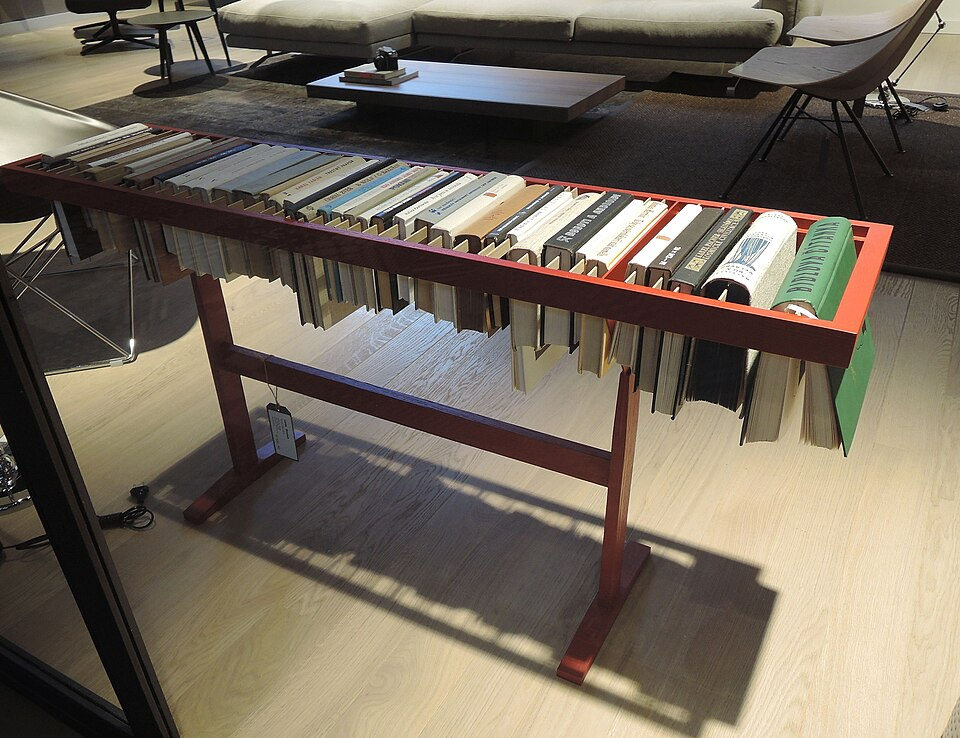

# Context-Rich Mechanics of Materials Problem

# Overhanging Book-Display Rack — Distributed Loading, Bending, and Deflection

## Engineering Context

{fig-alt="A freestanding rack with books suspended from a longitudinal rail." width=72%}

This photograph provides application context only. No dimension, load, support condition, or material property in this problem was measured or inferred from it.

A furniture maker is evaluating a freestanding rack from which books are suspended. The load-bearing longitudinal rail projects beyond two interior frame supports. Model one rail as a single prismatic overhanging Euler–Bernoulli beam. Fifteen books occupy three assigned intervals and the rail's self-weight acts over its full length.

## Main Engineering Goal

Determine support reactions, shear and bending-moment response, maximum bending stress, and maximum absolute vertical deflection. Compare the idealized rail with the assigned strength and serviceability criteria, while recognizing that this beam analysis does not certify the complete furniture.

## Assigned Data

- rail length: {{book_rack_L_m}} m; supports at x={{book_rack_support_A_m}} m and x={{book_rack_support_B_m}} m
- rectangular section: width B={{book_rack_width_m}} m; vertical thickness h={{book_rack_thickness_m}} m
- assigned density ρ={{book_rack_density_kg_m3}} kg/m³; effective modulus E={{book_rack_E_GPa}} GPa; g={{book_rack_g_m_s2}} m/s²
- assigned flexural allowable: {{book_rack_sigma_allow_MPa}} MPa
- assigned absolute deflection limit: L/{{book_rack_deflection_ratio}}
- Group A: {{book_rack_A_count}} books at {{book_rack_A_mass_kg}} kg each over x={{book_rack_A_start_m}}–{{book_rack_A_end_m}} m
- Group B: {{book_rack_B_count}} books at {{book_rack_B_mass_kg}} kg each over x={{book_rack_B_start_m}}–{{book_rack_B_end_m}} m
- Group C: {{book_rack_C_count}} books at {{book_rack_C_mass_kg}} kg each over x={{book_rack_C_start_m}}–{{book_rack_C_end_m}} m

All values are explicit instructional assumptions rather than verified product specifications.

## Analysis Scope

Replace each book group with one equivalent uniformly distributed load over its occupied interval. Include uniform rail self-weight. Use simple vertical supports, small-deflection linear elasticity, and a prismatic beam. Do not model fifteen individual book loads. Local hangers, joints, three-dimensional frame action, torsion, uplift restraint, tipping, and long-term creep are outside this analysis.

For deflection, define ⟨x−c⟩ⁿ=(x−c)ⁿ for x≥c and zero otherwise. If each distributed load is represented by (q,l,r), including self-weight, use

$$G(x)=\frac{A_y}{6}\langle x-a\rangle^3+\frac{B_y}{6}\langle x-b\rangle^3-\sum\frac{q}{24}\left[\langle x-l\rangle^4-\langle x-r\rangle^4\right],$$

$$v(x)=\frac{G(x)+C_1x+C_2}{EI},$$

with v(a)=v(b)=0. A spreadsheet or numerical root finder may be used to locate deflection extrema.
