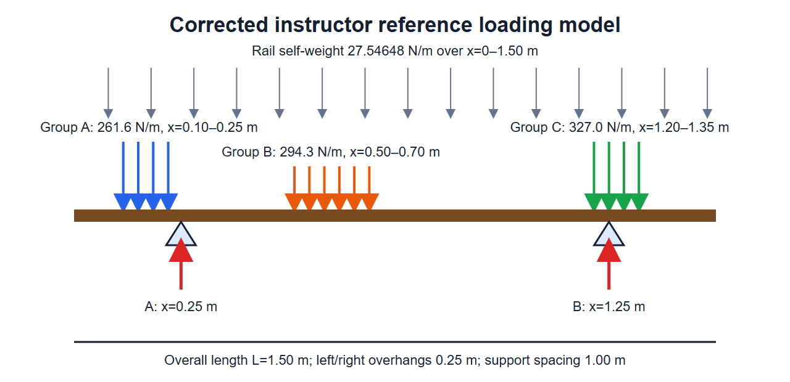
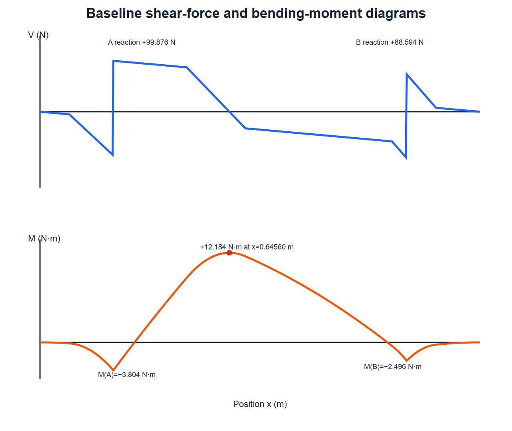
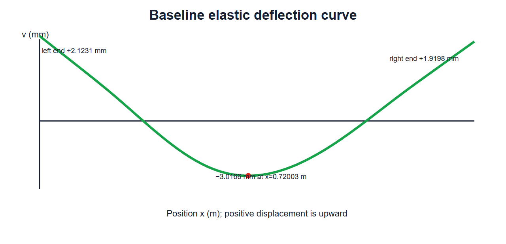

# Purpose

Representative answers emphasize load-path reasoning, equivalent distributed loading, equilibrium, shear and moment, flexure, elastic deflection, and a carefully scoped recommendation.



## Instructor Reference Loading Model

{fig-alt="Overhanging beam with supports at 0.25 and 1.25 meters, three book-load intervals, and uniform rail self-weight." width=100%}

The supplied faculty diagram was not reused because its displayed Group A, B, and C intervals differed from the revised authoritative inputs. This replacement shows A at 0.10–0.25 m, B at 0.50–0.70 m, C at 1.20–1.35 m, and self-weight over the full 1.50 m rail.

## Generated Questions and Solutions

```{=html}
<div id="overhanging-book-display-rack-bending-deflection-instructor-questions"></div>
<script src="../../data/problem-catalog.js"></script><script src="../../scripts/packet-renderer.js"></script>
<script>document.addEventListener("DOMContentLoaded",()=>window.renderProblemPacket({slug:"overhanging-book-display-rack-bending-deflection",targetId:"overhanging-book-display-rack-bending-deflection-instructor-questions",type:"instructor"}));</script>
```

## Instructor Solution Plots

{fig-alt="Baseline shear force and bending moment diagrams with critical values labeled." width=100%}

{fig-alt="Baseline beam deflection curve showing upward end displacement and maximum downward displacement." width=100%}

# Model Scope and Provenance

The photograph is by Dobroš, described on Wikimedia Commons as own work and licensed CC BY-SA 4.0. The photograph illustrates a furniture application only. The one-dimensional beam geometry, load intervals, book masses, density, modulus, allowable stress, and L/240 criterion are instructional assumptions from the revised faculty package.

The model omits local hanger forces, connection stresses, joint flexibility, three-dimensional frame action, out-of-plane torsion, uplift-restraint details, frame stability and tipping, and long-term wood creep. Passing the two assigned rail checks is not certification of the complete furniture.
