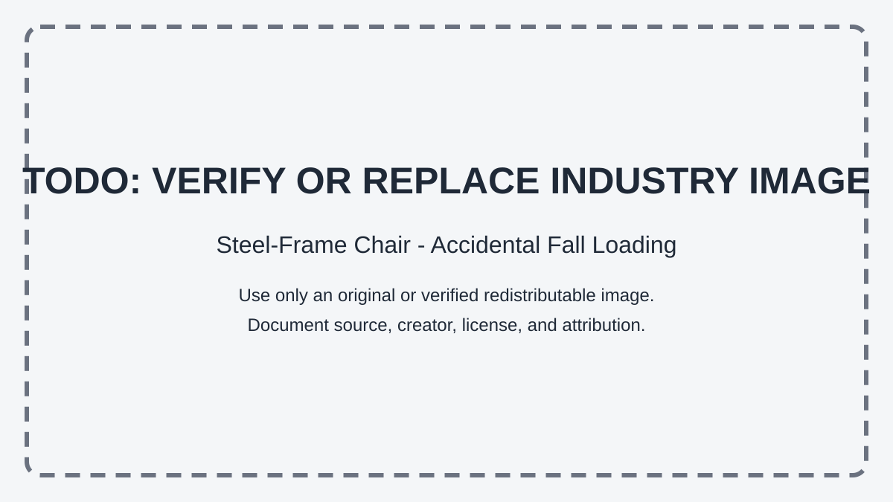

# Context-Rich Solid Mechanics Problem

## Steel-Frame Chair - Accidental Fall Loading

### Engineering Context

A steel-frame chair experiences dead loading from its own weight, live loading from an ordinarily seated occupant, and accidental loading when a person lands heavily on the seat. For this problem, the accidental event is represented by a **given 6.0 kN equivalent-static vertical design load**. It is an instructor-assigned preliminary screening load; no fall-height, stopping-distance, impact-duration, or impact-force derivation is required.

{fig-alt="Placeholder for a future verified redistributable photograph of a steel-frame chair." width=76%}

::: {.callout-warning title="TODO: VERIFY OR REPLACE INDUSTRY IMAGE"}
The supplied chair photograph is not included because its original creator, source, redistribution license, and correct attribution could not be verified. Replace this placeholder only with an original or verified redistributable image and document its provenance.
:::

The chair dead load is 150 N. A 90 kg seated occupant produces the normal live load. Detailed bending calculations focus exclusively on the given 6.0 kN accidental design case.

### Main Engineering Goal

Use the specified accidental vertical seat load to determine bending stress in one idealized transverse seat-support rail, calculate factor of safety, determine the maximum allowable total accidental load, and assess whether the rail meets the required strength criterion.

### System Components

- seat or cushion, which receives and distributes vertical contact load;
- two equivalent transverse seat-support rails, assumed to share the seat load equally;
- left and right side frames, which receive rail-end forces and moments;
- idealized moment-transferring rail-to-frame connections; and
- chair legs and floor contacts, which complete the load path.

### Scope of the Model

Analyze one straight prismatic square-hollow steel rail as a fixed-fixed beam of span (L) with a centered load (P_{rail}=P_A/2). Treat the end connections as rigid for this idealization. Use linear-elastic flexure through first yield and small deformation. The two rails, equal load sharing, section geometry, material properties, and rigid joints are instructor-assigned features, not measurements or verified construction details from a photograph. Exclude weld-bead stress, local buckling, fatigue, local seat contact, chair tipping or sliding, vibration, and full impact dynamics.
