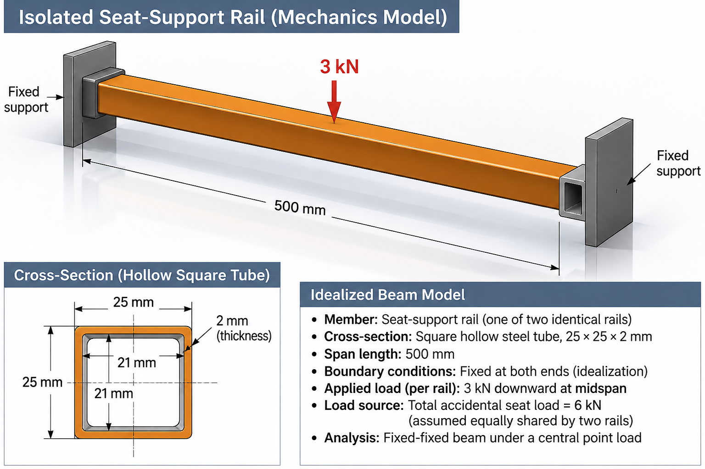

# Purpose

Award credit for correct load classification, a defensible load path, the prescribed two-rail load-sharing model, a complete fixed-fixed-beam free-body diagram, correct section properties and flexural stress, and an engineering conclusion that preserves the baseline failure outcome.

::: {.callout-warning title="TODO: VERIFY OR REPLACE INDUSTRY IMAGE"}
The supplied chair photograph is intentionally excluded because its creator, source, redistribution license, and attribution could not be verified. Replace the student placeholder only with an original or verified redistributable image. Keep this notice and the associated open GitHub issue until replacement is complete.
:::

# Problem Context



# Instructor Reference Idealization

{fig-alt="Instructor-only mechanics visualization of a 500 mm fixed-fixed hollow square rail with a centered 3 kN downward load and a 25 by 25 by 2 mm cross-section." width=94%}

The displayed rail load is $P_{\mathrm{rail}}=P_A/2=3.0\ \mathrm{kN}$. Although the new visualization does not show them, each vertical reaction has magnitude $P_{\mathrm{rail}}/2=1.5\ \mathrm{kN}$, and each fixed-end moment has magnitude $P_{\mathrm{rail}}L/8=187.5\ \mathrm{N\,m}$. The two support moments have opposing senses in the symmetric fixed-fixed solution.

# Generated Question Set and Solutions

```{=html}
<div id="steel-frame-chair-instructor-questions"></div>
<script src="../../data/problem-catalog.js"></script>
<script src="../../scripts/packet-renderer.js"></script>
<script>
document.addEventListener("DOMContentLoaded", () => {
  window.renderProblemPacket({slug: "steel-frame-chair-accidental-fall-loading", targetId: "steel-frame-chair-instructor-questions", type: "instructor"});
});
</script>
```

# Scope and Instructor Context

The 6.0 kN accidental load is a given equivalent-static preliminary design load, not a measured peak force or furniture-standard requirement. It is approximately 6.8 times the 90 kg occupant's static weight; an illustrative factor near seven motivates the scenario but is not a verified impact factor. Do not ask students to derive the load from fall height, stopping distance, impact duration, or collision dynamics.

Two rails, equal sharing, the 500 mm span, 25 x 25 x 2 mm square hollow section, perfectly fixed ends, steel properties, and moment-transferring welded-frame connections are instructor-assigned hypothetical features. They are not measurements or verified construction details of the photographed chair. Detailed weld stress, local buckling, fatigue, seat contact, tipping, sliding, and transient response remain outside scope.

# Supplemental Assessment Structure

- load classification, context, and load path: 20%;
- student idealization, restraint interpretation, and assumptions: 20%;
- beam bending and section properties: 25%;
- flexural stress and factor of safety: 20%;
- allowable load, recommendation, and limitations: 15%.
