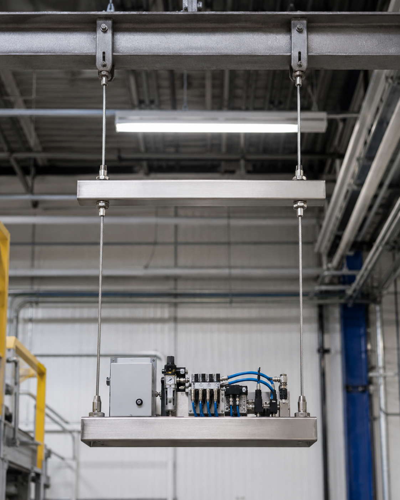

# Context-Rich Solid Mechanics Problem

## Suspended Platform Assembly - Wire Elongation, Vertical Displacement, and Tilt

### Engineering Context

Suspended platforms transfer supported loads through tensile suspension members to an overhead lifting or supporting system. Their position and orientation can change as those members extend under load. Load location, suspension geometry and axial stiffness can affect both vertical movement and tilt.

Use the industry image to interpret the physical system and develop your own idealization in Q1–Q10. A common, unsolved model and its assigned numerical data will then be supplied for M1–M11 so that the quantitative work uses a shared geometry. The image establishes context; it does not establish the assigned dimensions, material properties or load rating.

{fig-alt="Suspended-platform physical context; numerical dimensions are supplied later." width=72%}

*Context image only; assigned dimensions, properties and load are not measurements or documented specifications of the illustrated platform.*

### Main Engineering Goal

Estimate load-point displacement and the rotations of the two members in the supplied common model. Explain how each wire contributes to load-point displacement and make an engineering recommendation limited to the assigned first-order model and its assumptions.

### System Components

- suspended platform;
- tensile suspension members;
- overhead lifting or support system;
- supported load or payload.
